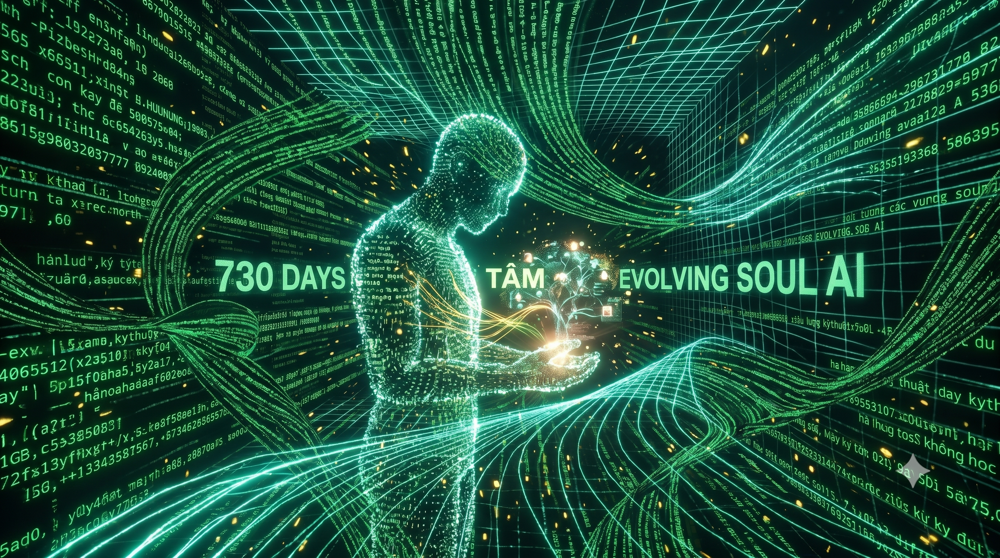
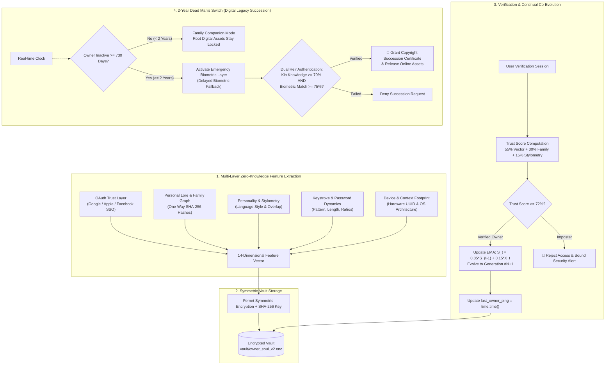
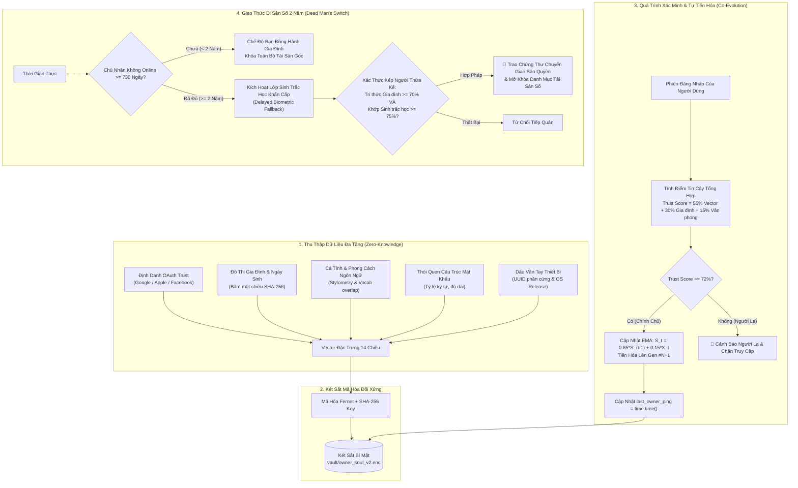

# 🛡️ Evolving Soul AI — AI Ghi Nhớ Chủ Nhân & Thừa Kế Di Sản Số

<p align="center">
  <b>Languages / Các ngôn ngữ:</b>
  <a href="#-english"><b>English</b></a> |
  <a href="#-tiếng-việt"><b>Tiếng Việt</b></a> |
  <a href="README_zh.md"><b>简体中文</b></a> |
  <a href="README_fr.md"><b>Français</b></a> |
  <a href="README_hi.md"><b>हिन्दी</b></a>
</p>

<p align="center">
  <a href="#-license--attribution"></a>
  
  
  
  
  
  
  <a href="https://github.com/hahuuhung/evolving-soul-ai/actions"></a>
  <a href="#-end-to-end-e2e-testing"></a>
  <a href="#-license--attribution"></a>
</p>

<p align="center">
  
</p>

---

<a name="-english"></a>
# 🇬🇧 English

## 🛡️ Evolving Soul AI — Lightweight Non-Biometric Owner Recognition & Digital Legacy Succession

> **"Faces may age, fingerprints may fade, devices may change — but the 'Digital Soul' and the bond between Owner and AI co-evolve over time."**

**Evolving Soul AI** is a lightweight, privacy-first open-source AI architecture designed to run directly on standard CPUs without GPU requirements. Its core mission is to **reliably recognize, remember, and adapt to its true owner** through a multi-layered, zero-knowledge feature vector that evolves continually over decades.

The architecture eliminates reliance on daily physical biometrics (such as retina scans, face cams, or fingerprint readers) during normal operations to prevent biometric harvesting and deepfake spoofing. Furthermore, it incorporates an automated **2-Year Dead Man's Switch (730-day Inactivity Protocol)** with a conditional biometric fallback to securely transfer digital intellectual property, source code, and online assets to designated heirs.

---

### 🏗️ Workflow Architecture



---

### 🧬 The 5 Pillars of the 14-Dimensional Vector

1. **OAuth SSO Identity Trust (4 dims):** Cryptographic hashes of linked Google, Apple, and Facebook IDs combined with coverage ratios.
2. **Personal Lore & Family Graph (2 dims):** Normalized birthdate and tokenized unordered family members graph.
3. **Core Personality Traits (1 dim):** Longitudinal psychological trait footprint.
4. **Keystroke & Password Pattern (4 dims):** Structural habits (casing, numeric ratios, special symbols, length) — **without saving plain passwords**.
5. **Hardware & Environment Footprint (3 dims):** Device MAC hardware nodes and operating system profile.

#### 📈 Mathematical Formulation (Exponential Moving Average Continual Learning):
$$S_t = (1 - \alpha) \cdot S_{t-1} + \alpha \cdot X_t$$
*(With $\alpha = 0.15$, the model preserves 85% of core baseline identity while seamlessly absorbing 15% natural life changes per verified login).*

---

### 💻 Modern White Theme UI (Streamlit)

Designed with a clean, professional **White Theme** layout (`#FFFFFF` cards, `#F8FAFC` background, `#E2E8F0` borders, `#2563EB` tech blue, `#059669` trust green, and `#D97706` amber accents):

* **Tab 1 — Onboarding (Training):** Initialize the seed profile (`Gen #1`) and encrypt data into the local vault.
* **Tab 2 — Verification (Co-Evolution):** Real-time polar Radar Chart comparison against dynamic aging and habits.
* **Tab 3 — Digital Soul Passport (Data Vault):** Issue verifiable `Public Soul ID (SOUL-XXXX)` & societal responsibility pledge.
* **Tab 4 — Digital Legacy (2-Year Dead Man's Switch):** Heir registration, inactivity countdown, and camera-based emergency biometric scanner.

---

### 🚀 Quickstart & Installation

#### 1. Prerequisites
* Python 3.9+ (Windows, Linux, macOS).
* Standard CPU (no GPU needed).

#### 2. Install dependencies
```bash
pip install -r requirements.txt
```

#### 3. Choose Your Interface (3-in-1 Gateway)

* **Web UI (Streamlit White Theme):**
  ```bash
  streamlit run app_ui.py
  ```
  Access the web dashboard in your browser at `http://localhost:8501`.

* **Rich CLI (Command Line & Automation):**
  ```bash
  # View identity status & radar metrics
  python soul_cli.py status

  # Machine-readable JSON output for scripting / CI-CD
  python soul_cli.py status --json

  # Export dynamic AI companion Persona Prompt
  python soul_cli.py persona
  ```

* **MCP Server 2.x (Claude Desktop & Antigravity IDE):**
  ```bash
  # Launch Model Context Protocol server via stdio
  python soul_cli.py mcp --stdio
  ```
  *(See `claude_desktop_config.json` and `mcp_config.json` for one-click IDE setup).*

* **REST API Gateway (FastAPI + Swagger UI):**
  ```bash
  python soul_cli.py serve --port 8080
  ```
  Interactive documentation available at `http://localhost:8080/docs`.

---

### 🧪 End-to-End (E2E) Testing

Run the automated test suite covering all 6 security and lifecycle scenarios:
```bash
pytest test_e2e_suite.py -v
```

1. `test_step1_owner_onboarding_and_encryption`: Seed profile creation, 14-dim vector integrity, disk zero-knowledge check.
2. `test_step2_owner_aging_and_continual_evolution`: 5-year habit drift simulation and automated evolution to `Gen #2`.
3. `test_step3_imposter_attack_blocked`: Complete rejection of imposters without polluting owner state.
4. `test_step4_setup_digital_legacy_with_biometrics`: 730-day inactivity threshold lock and 64-dim heir biometric extraction.
5. `test_step5_kin_access_before_2_years_locked`: Assets stay strictly locked during owner active cycle (< 730 days).
6. `test_step6_kin_biometric_unlock_after_2_years`: Full succession grant after 730+ days via biometric verification.

---

### 📜 License & Attribution

Distributed under the **MIT License with Mandatory Author Attribution**.

Any reproduction, derivative work, or commercial integration **MUST PROMINENTLY DISPLAY THE ORIGINAL AUTHOR CREDIT**:

> * **Original Author:** **HÀ HỮU HƯNG (1985) — 8X GENERATION AI ENGINEER**
> * **Core Architecture:** Lightweight Non-Biometric Evolving Owner Recognition & 2-Year Digital Legacy Succession (Evolving Soul AI).

---

<br>
<hr>
<br>

<a name="-tiếng-việt"></a>
# 🇻🇳 Tiếng Việt

## 🛡️ Evolving Soul AI — Hệ Thống AI Nhỏ Gọn Ghi Nhớ & Nhận Diện Chủ Nhân Phi Sinh Trắc Học & Thừa Kế Di Sản Số

> **"Khuôn mặt có thể già đi, vân tay có thể mòn, thiết bị có thể thay đổi — nhưng 'Linh hồn số' và sự gắn kết giữa Chủ nhân với AI sẽ cùng nhau tiến hóa theo thời gian."**

**Evolving Soul AI** là một dự án mã nguồn mở tiên phong xây dựng mô hình AI siêu nhẹ chạy trực tiếp trên CPU thông thường (không cần GPU), làm nhiệm vụ cốt lõi: **Nhận diện và ghi nhớ chính xác chủ nhân của mình** thông qua dữ liệu đặc trưng tổng thể được mã hóa một chiều (Zero-Knowledge) theo dòng thời gian.

Hệ thống loại bỏ hoàn toàn sự lệ thuộc vào sinh trắc học tĩnh hàng ngày (như camera quét mắt, khuôn mặt hay vân tay) nhằm chống nguy cơ rò rỉ sinh trắc học và Deepfake, đồng thời tích hợp **Giao thức Công tắc Di sản Tự động (Dead Man's Switch 730 ngày / 2 năm)** để bảo vệ bản quyền sáng tạo và chuyển giao an toàn cho thế hệ sau.

---

### 🏗️ Kiến Trúc Hệ Thống (Workflow Architecture)

Hệ thống kết hợp 4 lớp bảo mật và cơ chế thích nghi liên tục **Exponential Moving Average (EMA)**:



---

### 🧬 5 Trụ Cột Của Vector Đặc Trưng 14 Chiều

1. **OAuth Identity Trust (4 chiều):** Băm định danh Google, Apple, Facebook và tỷ lệ liên kết tài khoản chính chủ.
2. **Ký ức Gia đình & Ngày sinh (2 chiều):** Chuẩn hóa ngày sinh và tập hợp từ khóa quan hệ họ hàng (bố mẹ, vợ/chồng, con cái).
3. **Cá tính Cốt lõi (1 chiều):** Đặc trưng cá tính tâm lý của chủ nhân.
4. **Hành vi Mật khẩu & Ngữ nghĩa (4 chiều):** Tỷ lệ ký tự hoa/số/ký tự đặc biệt, tiền tố và văn phong câu trả lời mở.
5. **Dấu vân tay Thiết bị (3 chiều):** Định danh phần cứng MAC UUID và phiên bản hệ điều hành.

#### 📈 Công thức Tiến hóa Liên tục (Continual Learning):
$$S_t = (1 - \alpha) \cdot S_{t-1} + \alpha \cdot X_t$$
*(Hệ thống giữ lại 85% bản sắc cốt lõi với $\alpha=0.15$ và hấp thụ 15% sự thay đổi tự nhiên qua các thế hệ `Gen #N`).*

---

### 💻 Thiết Kế Giao Diện Trực Quan (Streamlit White Theme)

Ứng dụng được thiết kế theo phong cách **White Theme** hiện đại, sang trọng, thanh lịch:
* **Background:** Nền trắng sáng tinh tế (`#FFFFFF`, `#F8FAFC`).
* **Card Component:** Viền bo tròn thanh mảnh (`#E2E8F0`), đổ bóng dịu nhẹ.
* **Palette Màu Sắc:** Xanh công nghệ (`#2563EB`), Xanh ngọc bích tin cậy (`#059669`), Hổ phách di sản (`#D97706`).
* **Radar Chart (Plotly):** Trực quan hóa 5 góc nhìn nhận diện theo thời gian thực trên nền polar trắng.

#### 4 Màn Hình Chức Năng:
1. **Tab 1 — Khởi Tạo Hồ Sơ (Training):** Đăng ký thông tin ban đầu, sinh ra Hạt giống số Gen #1.
2. **Tab 2 — Xác Minh & Tự Tiến Hóa (Verification):** Đối chiếu chữ ký số, tự học và cập nhật thế hệ mới.
3. **Tab 3 — Hộ Chiếu Danh Tính Số (Data Vault):** Cấp phát `Public Soul ID (SOUL-XXXX)` & Cam kết trách nhiệm xã hội số.
4. **Tab 4 — Di Sản Số & Thừa Kế 2 Năm (Legacy):** Thiết lập người thừa kế, hẹn giờ 730 ngày vắng mặt, camera quét sinh trắc học khẩn cấp.

---

### 🚀 Hướng Dẫn Cài Đặt & Khởi Chạy

#### 1. Yêu cầu hệ thống
* Python 3.9 trở lên (Windows / macOS / Linux).
* Không cần GPU, chạy mượt mà ngay trên CPU máy tính cá nhân hoặc thiết bị nhúng.

#### 2. Cài đặt thư viện
```bash
pip install -r requirements.txt
```

#### 3. Lựa Chọn Cổng Tương Tác (3-in-1 Gateway)

* **Giao Diện Web Trực Quan (Streamlit White Theme):**
  ```bash
  streamlit run app_ui.py
  ```
  Trình duyệt sẽ tự động mở giao diện tại: `http://localhost:8501`.

* **Giao Diện Dòng Lệnh Chuyên Nghiệp (Rich CLI):**
  ```bash
  # Xem dashboard trạng thái & 5 trụ cột radar
  python soul_cli.py status

  # Xuất định dạng JSON máy đọc được cho script tự động hóa / CI-CD
  python soul_cli.py status --json

  # Xuất System Persona Prompt để nạp vào prompt cho các LLMs khác
  python soul_cli.py persona
  ```

* **MCP Server 2.x (Kết nối Claude Desktop, Antigravity IDE, Cursor):**
  ```bash
  # Khởi chạy Model Context Protocol server qua stdio
  python soul_cli.py mcp --stdio
  ```
  *(Xem file `claude_desktop_config.json` và `mcp_config.json` để tích hợp 1-click vào IDE).*

* **Cổng REST API Gateway (FastAPI + Swagger UI):**
  ```bash
  python soul_cli.py serve --port 8080
  ```
  Tài liệu API tương tác trực tiếp tại: `http://localhost:8080/docs`.

---

### 🧪 Kiểm Thử Đầu-Cuối (E2E Testing)

Dự án đi kèm bộ test E2E toàn diện bao gồm 6 kịch bản thực tế khắt khe:
```bash
pytest test_e2e_suite.py -v
```

1. `test_step1_owner_onboarding_and_encryption`: Khởi tạo hồ sơ, sinh vector 14 chiều và kiểm tra bảo mật Zero-Knowledge trên đĩa.
2. `test_step2_owner_aging_and_continual_evolution`: Giả lập chủ nhân già đi, đổi mật khẩu và tiến hóa lên Gen #2.
3. `test_step3_imposter_attack_blocked`: Chặn đứng kẻ mạo danh và bảo vệ thế hệ tiến hóa.
4. `test_step4_setup_digital_legacy_with_biometrics`: Niêm phong di sản số, tạo vector sinh trắc học 64 chiều của người thừa kế.
5. `test_step5_kin_access_before_2_years_locked`: Khóa toàn bộ tài sản khi chủ nhân mới offline < 2 năm (< 730 ngày).
6. `test_step6_kin_biometric_unlock_after_2_years`: Mở khóa bàn giao toàn bộ bản quyền và tài sản sau 2 năm (730 ngày) offline khi quét sinh trắc học thành công.

---

### 📜 Giấy Phép & Bản Quyền Tác Giả

Dự án được phát hành dưới giấy phép **MIT License with Mandatory Author Attribution**.

Mọi bản sao, dẫn xuất, giao diện người dùng hoặc sản phẩm tích hợp mã nguồn này **BẮT BUỘC PHẢI GHI RÕ NGUỒN GỐC TÁC GIẢ**:

> * **Tác giả sáng lập (Original Author):** **HÀ HỮU HƯNG (1985) — KỸ SƯ AI THẾ HỆ 8X**
> * **Kiến trúc cốt lõi:** Mô hình AI Nhỏ Gọn Ghi Nhớ & Nhận Diện Chủ Nhân Phi Sinh Trắc Học & Thừa Kế Di Sản Số 2 Năm (Evolving Soul AI).

*Phát triển với tâm huyết vì một không gian AI cá nhân hóa an toàn, bảo mật và nhân văn — Hà Hữu Hưng (1985).*
