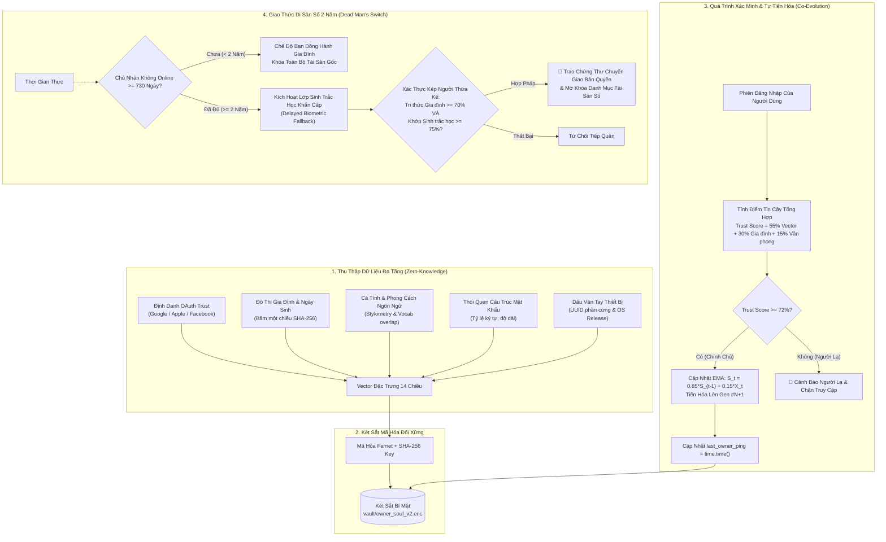

# 🛡️ Evolving Soul AI — Hệ Thống AI Nhỏ Gọn Ghi Nhớ & Nhận Diện Chủ Nhân Phi Sinh Trắc Học & Thừa Kế Di Sản Số

[-blue.svg)](#-giấy-phép--bản-quyền-tác-giả)
[](https://www.python.org/)
[](https://streamlit.io/)
[-orange.svg)](#-giấy-phép--bản-quyền-tác-giả)
[](#-kiểm-thử-đầu-cuối-e2e-testing)

> **"Khuôn mặt có thể già đi, vân tay có thể mòn, thiết bị có thể thay đổi — nhưng 'Linh hồn số' và sự gắn kết giữa Chủ nhân với AI sẽ cùng nhau tiến hóa theo thời gian."**

---

## 🌟 Giới Thiệu Dự Án

**Evolving Soul AI** là một dự án mã nguồn mở tiên phong xây dựng mô hình AI siêu nhẹ chạy trực tiếp trên CPU, làm nhiệm vụ cốt lõi: **Nhận diện và ghi nhớ chính xác chủ nhân của mình** thông qua dữ liệu đặc trưng tổng thể được mã hóa một chiều (Zero-Knowledge) theo dòng thời gian.

Hệ thống loại bỏ hoàn toàn sự lệ thuộc vào sinh trắc học tĩnh hàng ngày (như camera quét mắt, khuôn mặt hay vân tay) nhằm chống nguy cơ rò rỉ sinh trắc học và Deepfake, đồng thời tích hợp **Giao thức Công tắc Di sản Tự động (Dead Man's Switch 730 ngày / 2 năm)** để bảo vệ bản quyền sáng tạo và chuyển giao an toàn cho thế hệ sau.

---

## 🏗️ Kiến Trúc Hệ Thống (Workflow Architecture)



---

## 🧬 5 Trụ Cột Của Vector Đặc Trưng 14 Chiều

1. **OAuth Identity Trust (4 chiều):** Băm định danh Google, Apple, Facebook và tỷ lệ liên kết tài khoản chính chủ.
2. **Ký ức Gia đình & Ngày sinh (2 chiều):** Chuẩn hóa ngày sinh và tập hợp từ khóa quan hệ họ hàng (bố mẹ, vợ/chồng, con cái).
3. **Cá tính Cốt lõi (1 chiều):** Đặc trưng cá tính tâm lý của chủ nhân.
4. **Hành vi Mật khẩu & Ngữ nghĩa (4 chiều):** Tỷ lệ ký tự hoa/số/ký tự đặc biệt, tiền tố và văn phong câu trả lời mở.
5. **Dấu vân tay Thiết bị (3 chiều):** Định danh phần cứng MAC UUID và phiên bản hệ điều hành.

**Công thức Tiến hóa Liên tục (Continual Learning):**
$$S_t = (1 - \alpha) \cdot S_{t-1} + \alpha \cdot X_t$$
*(Hệ thống giữ lại 85% bản sắc cốt lõi ($\alpha=0.15$) và hấp thụ 15% sự thay đổi tự nhiên qua các thế hệ `Gen #N`).*

---

## 💻 Thiết Kế Giao Diện Trực Quan (Streamlit White Theme)

Ứng dụng được thiết kế theo phong cách **White Theme** hiện đại, sang trọng, thanh lịch:
* **Background:** Nền trắng sáng tinh tế (`#FFFFFF`, `#F8FAFC`).
* **Card Component:** Viền bo tròn thanh mảnh (`#E2E8F0`), đổ bóng dịu nhẹ.
* **Palette Màu Sắc:** Xanh công nghệ (`#2563EB`), Xanh ngọc bích tin cậy (`#059669`), Hổ phách di sản (`#D97706`).
* **Radar Chart (Plotly):** Trực quan hóa 5 góc nhìn nhận diện theo thời gian thực trên nền polar trắng.

### 4 Màn Hình Chức Năng:
1. **Tab 1 — Khởi Tạo Hồ Sơ (Training):** Đăng ký thông tin ban đầu, sinh ra Hạt giống số Gen #1.
2. **Tab 2 — Xác Minh & Tự Tiến Hóa (Verification):** Đối chiếu chữ ký số, tự học và cập nhật thế hệ mới.
3. **Tab 3 — Hộ Chiếu Danh Tính Số (Data Vault):** Cấp phát `Public Soul ID (SOUL-XXXX)` & Cam kết trách nhiệm xã hội số.
4. **Tab 4 — Di Sản Số & Thừa Kế 2 Năm (Legacy):** Thiết lập người thừa kế, hẹn giờ 730 ngày vắng mặt, camera quét sinh trắc học khẩn cấp.

---

## 🚀 Hướng Dẫn Cài Đặt & Khởi Chạy

### 1. Yêu cầu hệ thống
* Python 3.9 trở lên (Windows / macOS / Linux).
* Không cần GPU, chạy mượt mà ngay trên CPU máy tính cá nhân hoặc thiết bị nhúng.

### 2. Cài đặt thư viện
```bash
pip install -r requirements.txt
```

### 3. Khởi chạy Ứng dụng Giao diện (Streamlit White Theme)
```bash
streamlit run app_ui.py
```
Trình duyệt sẽ tự động mở giao diện tại: `http://localhost:8501`.

---

## 🧪 Kiểm Thử Đầu-Cuối (E2E Testing)

Dự án đi kèm bộ test E2E toàn diện bao gồm 6 kịch bản thực tế khắt khe:
1. `test_step1_owner_onboarding_and_encryption`: Khởi tạo hồ sơ, sinh vector 14 chiều và kiểm tra bảo mật Zero-Knowledge trên đĩa.
2. `test_step2_owner_aging_and_continual_evolution`: Giả lập chủ nhân già đi, đổi mật khẩu và tiến hóa lên Gen #2.
3. `test_step3_imposter_attack_blocked`: Chặn đứng kẻ mạo danh và bảo vệ thế hệ tiến hóa.
4. `test_step4_setup_digital_legacy_with_biometrics`: Niêm phong di sản số, tạo vector sinh trắc học 64 chiều của người thừa kế.
5. `test_step5_kin_access_before_2_years_locked`: Khóa toàn bộ tài sản khi chủ nhân mới offline < 2 năm (< 730 ngày).
6. `test_step6_kin_biometric_unlock_after_2_years`: Mở khóa bàn giao toàn bộ bản quyền và tài sản sau 2 năm (730 ngày) offline khi quét sinh trắc học thành công.

Chạy kiểm thử bằng lệnh:
```bash
pytest test_e2e_suite.py -v
```

---

## 📜 Giấy Phép & Bản Quyền Tác Giả

Dự án được phát hành dưới giấy phép **MIT License with Mandatory Author Attribution**.

Mọi bản sao, dẫn xuất, giao diện người dùng hoặc sản phẩm tích hợp mã nguồn này **BẮT BUỘC PHẢI GHI RÕ NGUỒN GỐC TÁC GIẢ**:

> * **Tác giả sáng lập (Original Author):** **HÀ HỮU HƯNG (1985) — KỸ SƯ AI THẾ HỆ 8X**
> * **Kiến trúc cốt lõi:** Mô hình AI Nhỏ Gọn Ghi Nhớ & Nhận Diện Chủ Nhân Phi Sinh Trắc Học & Thừa Kế Di Sản Số 2 Năm (Evolving Soul AI).

*Phát triển với tâm huyết vì một không gian AI cá nhân hóa an toàn, bảo mật và nhân văn — Hà Hữu Hưng (1985).*
