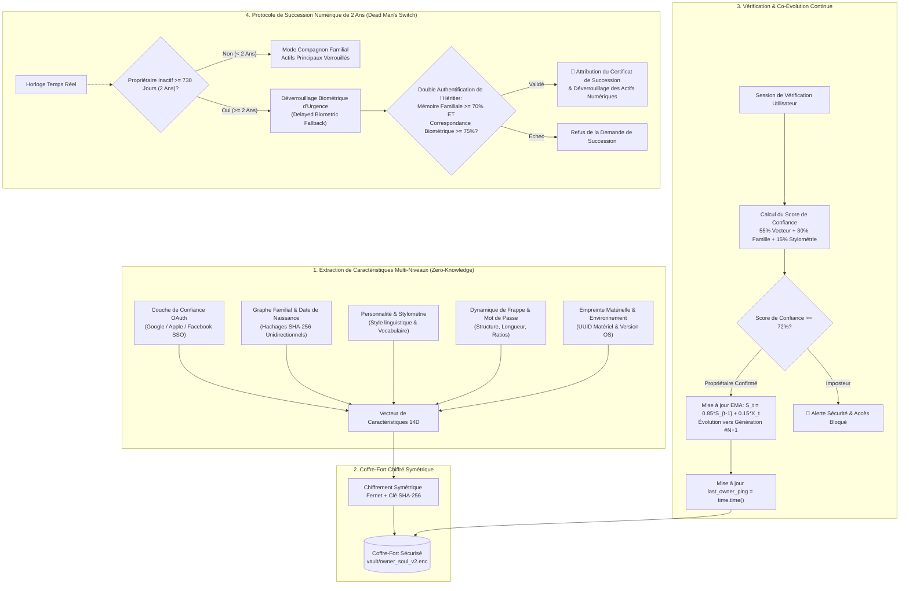

# 🛡️ Evolving Soul AI — Reconnaissance du Propriétaire Sans Données Biométriques & Succession de Patrimoine Numérique

<p align="center">
  <b>Langues / Languages:</b>
  <a href="README.md#-english"><b>English</b></a> |
  <a href="README.md#-tiếng-việt"><b>Tiếng Việt</b></a> |
  <a href="README_zh.md"><b>简体中文</b></a> |
  <a href="README_fr.md"><b>Français</b></a> |
  <a href="README_hi.md"><b>हिन्दी</b></a>
</p>

<p align="center">
  <a href="#-licence--attribution-de-lauteur"></a>
  
  
  <a href="https://github.com/hahuuhung/evolving-soul-ai/actions"></a>
  <a href="#-tests-de-bout-en-bout-e2e-testing"></a>
  <a href="#-licence--attribution-de-lauteur"></a>
</p>

> **« Les visages vieillissent, les empreintes s'estompent, les appareils changent — mais "l'Âme Numérique" et le lien entre le Propriétaire et l'IA évoluent ensemble au fil du temps. »**

**Evolving Soul AI** est une architecture open source pionnière et ultra-légère, conçue pour fonctionner localement sur CPU standard (sans GPU). Sa mission essentielle : **reconnaître, mémoriser et s'adapter avec précision à son véritable propriétaire** sur plusieurs décennies grâce à un vecteur de caractéristiques chiffré à sens unique (Zero-Knowledge).

Ce système élimine toute dépendance à la biométrie physique quotidienne (caméras faciales, scanners rétiniens ou d'empreintes digitales), protégeant ainsi l'utilisateur contre les fuites de données biométriques et le Deepfake. Il intègre de plus un **Protocole d'Inactivité de 2 Ans (Dead Man's Switch de 730 jours)** avec secours biométrique conditionnel pour léguer en toute sécurité les œuvres de l'esprit, dépôts de code et actifs numériques aux ayants droit.

> **⚠️ Mise à jour V3 :** la suite de ce document décrit l'architecture V2. En V3, la clé maîtresse est enveloppée par une phrase secrète (Scrypt), les données sensibles ne sont stockées qu'en HMAC-SHA256, le score à 5 piliers utilise un seuil de 0,62, la reconnaissance faciale de l'héritier repose sur OpenCV YuNet + SFace, et des passerelles CLI / MCP / REST sont fournies. Pour l'installation et la sécurité à jour, voir [README.md (English)](README.md#-english) et [docs/WALKTHROUGH.md](docs/WALKTHROUGH.md).

---

## 🏗️ Architecture du Système (Workflow Architecture)



---

## 🧬 Les 5 Piliers du Vecteur 14 Dimensions

1. **Confiance d'Identité OAuth (4 dims) :** Empreintes hachées des comptes Google, Apple, Facebook et taux de liaison.
2. **Mémoire Familiale & Date de Naissance (2 dims) :** Date de naissance normalisée et graphe de parenté tokenisé.
3. **Traits de Personnalité (1 dim) :** Empreinte psychologique longitudinale.
4. **Comportement de Saisie & Mot de Passe (4 dims) :** Habitudes structurelles (majuscules, chiffres, symboles) — **sans jamais stocker le mot de passe réel**.
5. **Empreinte Matérielle & Système (3 dims) :** Nœud matériel MAC et version du système d'exploitation.

#### 📈 Formule Mathématique (Apprentissage Continu par Moyenne Mobile Exponentielle) :
$$S_t = (1 - \alpha) \cdot S_{t-1} + \alpha \cdot X_t$$
*(Avec $\alpha = 0,15$, le modèle conserve 85% du profil fondamental et intègre en douceur 15% des changements naturels de la vie à chaque connexion validée).*

---

## 💻 Interface Épurée Thème Blanc (Streamlit White Theme)

Conçue selon les standards professionnels du **White Theme** (cartes `#FFFFFF`, arrière-plan gris perle `#F8FAFC`, bordures `#E2E8F0`, bleu technologique `#2563EB`, vert émeraude `#059669` et or ambré `#D97706`) :

* **Tab 1 — Création du Profil (Training) :** Génération de la graine numérique (`Gen #1`) chiffrée dans le coffre local.
* **Tab 2 — Vérification & Évolution (Verification) :** Graphique Radar polaire en temps réel comparant le vieillissement et les habitudes.
* **Tab 3 — Passeport d'Âme Numérique (Data Vault) :** Délivrance d'un identifiant public `Public Soul ID (SOUL-XXXX)` avec déclaration d'éthique numérique.
* **Tab 4 — Héritage Numérique & Délai de 2 Ans (Legacy) :** Enregistrement de l'héritier, compteur d'inactivité et lecteur biométrique d'urgence via webcam.

---

## 🚀 Installation & Lancement Rapide

### 1. Prérequis
* Python 3.9+ (Windows, Linux, macOS).
* Fonctionne sur CPU standard (aucun GPU requis).

### 2. Installation des dépendances
```bash
pip install -r requirements.txt
```

### 3. Lancer l'application
```bash
streamlit run app_ui.py
```
Ouvrez votre navigateur sur `http://localhost:8501`.

---

## 🧪 Tests de Bout en Bout (E2E Testing)

Exécutez la suite de tests automatisés validant l'ensemble des 6 scénarios critiques :
```bash
pytest test_e2e_suite.py -v
```

1. `test_step1_owner_onboarding_and_encryption` : Création de profil, vecteur 14D et intégrité Zero-Knowledge sur le disque.
2. `test_step2_owner_aging_and_continual_evolution` : Simulation de 5 ans de vieillissement et passage automatique à la `Gen #2`.
3. `test_step3_imposter_attack_blocked` : Rejet total d'un usurpateur sans altérer les données du propriétaire.
4. `test_step4_setup_digital_legacy_with_biometrics` : Fixation du seuil de 730 jours et extraction du vecteur biométrique 64D de l'héritier.
5. `test_step5_kin_access_before_2_years_locked` : Maintien strict du verrouillage pendant la période d'activité (< 730 jours).
6. `test_step6_kin_biometric_unlock_after_2_years` : Transfert complet des actifs après 2 ans grâce à la vérification biométrique.

---

## 📜 Licence & Attribution de l'Auteur

Distribué sous la **Licence MIT avec Obligation d'Attribution**.

Toute copie, modification, intégration logicielle ou commerciale **DOIT MENTIONNER CLAIREMENT L'AUTEUR ORIGINAL** :

> * **Auteur Créateur (Original Author) :** **HÀ HỮU HƯNG (1985) — INGÉNIEUR IA DE LA GÉNÉRATION 8X (KỸ SƯ AI THẾ HỆ 8X)**
> * **Architecture Fondamentale :** Reconnaissance du Propriétaire Sans Données Biométriques & Succession de Patrimoine Numérique après 2 Ans (Evolving Soul AI).

*Développé avec passion pour une ère de l'IA sécurisée, respectueuse de la vie privée et centrée sur l'humain — Hà Hữu Hưng (1985).*
