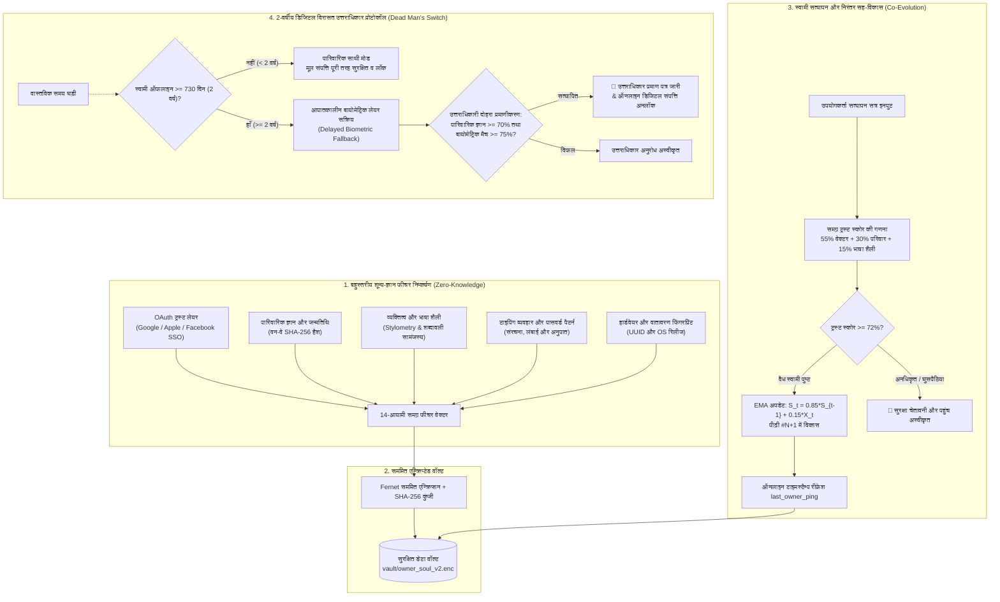

# 🛡️ Evolving Soul AI — गैर-बायोमेट्रिक स्वामी पहचान एवं 2-वर्षीय डिजिटल विरासत उत्तराधिकार प्रणाली

<p align="center">
  <b>भाषाएं / Languages:</b>
  <a href="README.md#-english"><b>English</b></a> |
  <a href="README.md#-tiếng-việt"><b>Tiếng Việt</b></a> |
  <a href="README_zh.md"><b>简体中文</b></a> |
  <a href="README_fr.md"><b>Français</b></a> |
  <a href="README_hi.md"><b>हिन्दी</b></a>
</p>

<p align="center">
  <a href="#-लाइसेंस-एवं-लेखक-श्रेय-attribution"></a>
  
  
  <a href="https://github.com/hahuuhung/evolving-soul-ai/actions"></a>
  <a href="#-एंड-टू-एंड-स्वचालित-परीक्षण-e2e-testing"></a>
  <a href="#-लाइसेंस-एवं-लेखक-श्रेय-attribution"></a>
</p>

> **"चेहरे उम्र के साथ बदल सकते हैं, उंगलियों के निशान मिट सकते हैं, उपकरण बदल सकते हैं — लेकिन 'डिजिटल आत्मा' और स्वामी व AI के बीच का संबंध समय के साथ विकसित होता रहता है।"**

**Evolving Soul AI** एक अत्याधुनिक, गोपनीयता-केंद्रित ओपन-सोर्स AI आर्किटेक्चर है जिसे बिना किसी महंगे GPU के सीधे सामान्य CPU पर कुशलतापूर्वक चलाने के लिए डिज़ाइन किया गया है। इसका मुख्य उद्देश्य: समय के साथ क्रमिक रूप से विकसित होने वाले वन-वे एन्क्रिप्टेड (Zero-Knowledge) फीचर वेक्टर के माध्यम से **दशकों तक अपने वास्तविक स्वामी को सटीक रूप से पहचानना, याद रखना और अनुकूलित होना है**।

यह प्रणाली दैनिक उपयोग के दौरान भौतिक बायोमेट्रिक्स (जैसे फेस कैमरा, रेटिना या फिंगरप्रिंट स्कैनर) पर निर्भरता को पूरी तरह समाप्त करती है, जिससे बायोमेट्रिक डेटा लीक और डीपफेक धोखाधड़ी का खतरा खत्म हो जाता है। साथ ही, इसमें **2-वर्षीय स्वचालित विरासत अंतरण प्रोटोकॉल (Dead Man's Switch / 730 दिन)** शामिल है, जो स्वामी के लंबे समय तक ऑफलाइन रहने पर आपातकालीन बायोमेट्रिक लॉक के जरिए बौद्धिक संपदा और डिजिटल संपत्ति को उत्तराधिकारियों को सुरक्षित सौंपता है।

---

## 🏗️ सिस्टम वर्कफ़्लो आर्किटेक्चर (Workflow Architecture)



---

## 🧬 14-आयामी फीचर वेक्टर के 5 मुख्य स्तंभ

1. **OAuth SSO पहचान ट्रस्ट (4 आयाम):** लिंक किए गए Google, Apple, Facebook खातों के हैश और अनुपात।
2. **पारिवारिक स्मृति और जन्मतिथि (2 आयाम):** मानकीकृत जन्मतिथि और बिना क्रम का पारिवारिक नेटवर्क।
3. **मुख्य व्यक्तित्व लक्षण (1 आयाम):** दीर्घकालिक मनोवैज्ञानिक डिजिटल विशेषताएं।
4. **टाइपिंग व्यवहार और पासवर्ड आदतें (4 आयाम):** अपरकेस, संख्यात्मक, विशेष वर्ण अनुपात — **मूल पासवर्ड कभी सेव नहीं होता**।
5. **हार्डवेयर और परिवेश फिंगरप्रिंट (3 आयाम):** डिवाइस MAC नोड और ऑपरेटिंग सिस्टम हस्ताक्षर।

#### 📈 निरंतर अधिगम गणितीय सूत्र (Continual Learning Formula):
$$S_t = (1 - \alpha) \cdot S_{t-1} + \alpha \cdot X_t$$
*($\alpha = 0.15$ के साथ, मॉडल 85% मूल पहचान आधार को बनाए रखता है और प्रत्येक सफल लॉगिन पर 15% प्राकृतिक जीवन परिवर्तनों को आत्मसात करता है, जिससे सहज `Gen #N` विकास होता है)।*

---

## 💻 आधुनिक श्वेत थीम इंटरफ़ेस (Streamlit White Theme)

स्वच्छ और पेशेवर **व्हाइट थीम (White Theme)** लेआउट (`#FFFFFF` कार्ड, `#F8FAFC` पृष्ठभूमि, `#E2E8F0` बॉर्डर, `#2563EB` टेक ब्लू, `#059669` ट्रस्ट ग्रीन, और `#D97706` एम्बर गोल्ड):

* **Tab 1 — प्रोफ़ाइल स्थापना (Training):** प्रारंभिक बीज प्रोफ़ाइल बनाएं और वॉल्ट में एन्क्रिप्ट करें (`Gen #1`)।
* **Tab 2 — सत्यापन और सह-विकास (Verification):** उम्र और आदतों के बदलाव को मापने वाला रीयल-टाइम पोलर रडार चार्ट।
* **Tab 3 — डिजिटल पासपोर्ट (Data Vault):** सार्वजनिक कोड `Public Soul ID (SOUL-XXXX)` और डिजिटल सामाजिक उत्तरदायित्व घोषणा।
* **Tab 4 — 2-वर्षीय डिजिटल विरासत (Legacy):** उत्तराधिकारी पंजीकरण, उलटी गिनती और वेबकैम बायोमेट्रिक स्कैनर।

---

## 🚀 त्वरित आरंभ एवं स्थापना

### 1. पूर्वापेक्षाएँ
* Python 3.9 या उच्चतर (Windows / Linux / macOS)।
* सामान्य CPU पर पूरी गति से संचालित।

### 2. पैकेज स्थापित करें
```bash
pip install -r requirements.txt
```

### 3. एप्लिकेशन चलाएं
```bash
streamlit run app_ui.py
```
अपने ब्राउज़र में खोलें: `http://localhost:8501`।

---

## 🧪 एंड-टू-एंड स्वचालित परीक्षण (E2E Testing)

सभी 6 महत्वपूर्ण सुरक्षा परिदृश्यों को सत्यापित करने वाला टेस्ट सूट चलाएं:
```bash
pytest test_e2e_suite.py -v
```

1. `test_step1_owner_onboarding_and_encryption`: प्रारंभिक पंजीकरण, 14-D वेक्टर और शून्य-ज्ञान डिस्क सुरक्षा जांच।
2. `test_step2_owner_aging_and_continual_evolution`: 5 साल बाद आदतों का बदलाव और स्वतः `Gen #2` में विकास।
3. `test_step3_imposter_attack_blocked`: स्वामी डेटा को प्रभावित किए बिना घुसपैठियों को पूरी तरह रोकना।
4. `test_step4_setup_digital_legacy_with_biometrics`: 730-दिवसीय सीमा निर्धारण और उत्तराधिकारी 64-D बायोमेट्रिक निष्कर्षण।
5. `test_step5_kin_access_before_2_years_locked`: स्वामी के सक्रिय चक्र (< 730 दिन) में संपत्ति का सुरक्षित व लॉक रहना।
6. `test_step6_kin_biometric_unlock_after_2_years`: 2 वर्ष बाद बायोमेट्रिक सत्यापन द्वारा संपत्ति का पूर्ण हस्तांतरण।

---

## 📜 लाइसेंस एवं लेखक श्रेय (Attribution)

यह प्रोजेक्ट **MIT लाइसेंस (अनिवार्य लेखक श्रेय के साथ)** के तहत जारी किया गया है।

किसी भी प्रति, संशोधन या व्यावसायिक उपयोग के दौरान **मूल लेखक की जानकारी प्रमुखता से प्रदर्शित करना अनिवार्य है**:

> * **मूल लेखक (Original Author):** **HÀ HỮU HƯNG (1985) — 8X पीढ़ी के एआई इंजीनियर (KỸ SƯ AI THẾ HỆ 8X)**
> * **मूल आर्किटेक्चर:** गैर-बायोमेट्रिक स्व-विकसित स्वामी पहचान एवं 2-वर्षीय डिजिटल विरासत उत्तराधिकार प्रणाली (Evolving Soul AI)।

*सुरक्षित, निजी और मानवीय संवेदनाओं से युक्त AI के भविष्य के लिए समर्पित — Hà Hữu Hưng (1985)।*
