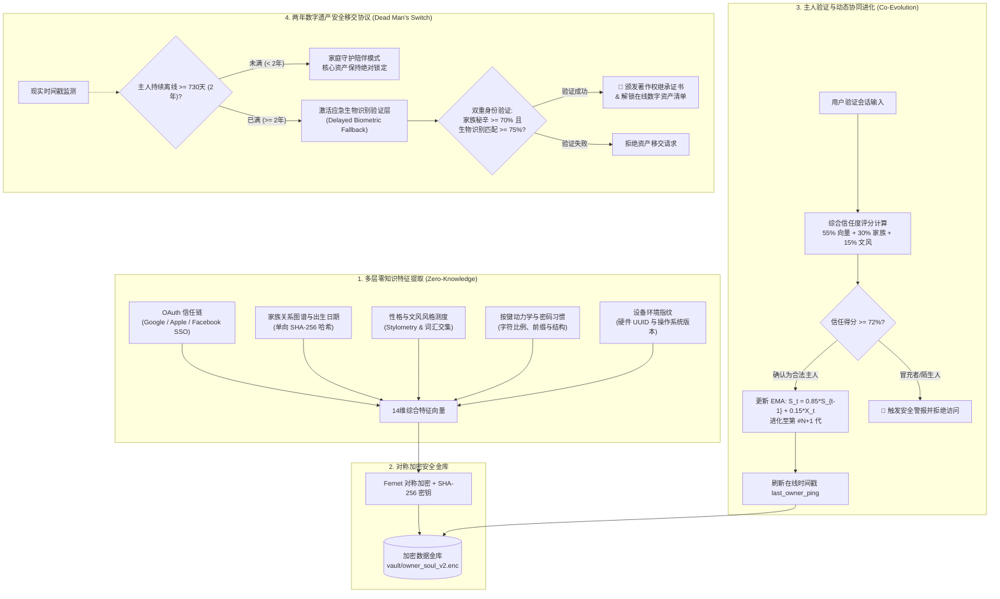

# 🛡️ Evolving Soul AI — 轻量级非生物识别主人识别与数字遗产继承系统

<p align="center">
  <b>语言 / Languages:</b>
  <a href="README.md#-english"><b>English</b></a> |
  <a href="README.md#-tiếng-việt"><b>Tiếng Việt</b></a> |
  <a href="README_zh.md"><b>简体中文</b></a> |
  <a href="README_fr.md"><b>Français</b></a> |
  <a href="README_hi.md"><b>हिन्दी</b></a>
</p>

<p align="center">
  <a href="#-开源许可证与作者署名"></a>
  
  
  <a href="https://github.com/hahuuhung/evolving-soul-ai/actions"></a>
  <a href="#-端到端自动化测试-e2e-testing"></a>
  <a href="#-开源许可证与作者署名"></a>
</p>

> **“容颜会老去，指纹会磨损，设备会更换——但‘数字灵魂’以及主人与人工智能之间的羁绊将随时间不断进化。”**

**Evolving Soul AI** 是一个先锋开源架构，专为在普通本地 CPU 上高效运行设计（无需昂贵显卡 GPU）。其核心使命是：通过时间维度单向加密（零知识证明 Zero-Knowledge）的综合特征向量，**跨越数十年精准识别、记忆并适应真正的主人**。

该系统在日常运行中完全摆脱了对物理生物识别（如人脸摄像头、视网膜或指纹扫描仪）的依赖，杜绝了生物特征泄露与 Deepfake 欺诈风险；同时开创性地整合了**两年离线自动遗产移交协议（Dead Man's Switch / 730天）**，在主人长期离线后，通过条件激活继承人生物识别锁，安全过渡其在线数字资产与知识产权。

---

## 🏗️ 系统工作流架构 (Workflow Architecture)



---

## 🧬 14维特征向量的五大支柱

1. **OAuth 身份信任层 (4维)：** 关联的 Google、Apple、Facebook 账号哈希值及综合覆盖率。
2. **家族记忆与出生日期 (2维)：** 经规范化的出生年月日以及无序分词家族网络。
3. **核心性格特质 (1维)：** 长期心理特质数字特征。
4. **行为动力学与密码结构 (4维)：** 大写、数字、特殊符号比例及长度——**绝不存储明文密码**。
5. **硬件环境指纹 (3维)：** 计算机 MAC 节点及操作系统发行版签名。

#### 📈 持续学习数学公式 (Exponential Moving Average Continual Learning):
$$S_t = (1 - \alpha) \cdot S_{t-1} + \alpha \cdot X_t$$
*(设 $\alpha = 0.15$，系统在每次成功认证后保留 85% 的核心特征底色，温和吸收 15% 的自然生活变化，实现平滑代际演化 `Gen #N`)。*

---

## 💻 极简白色主题界面 (Streamlit White Theme)

系统采用高雅专业的**白色主题 (White Theme)** 视觉设计（`#FFFFFF` 卡片、`#F8FAFC` 浅灰背景、`#E2E8F0` 边框、`#2563EB` 科技蓝、`#059669` 信任翠绿及 `#D97706` 遗产琥珀金）：

* **Tab 1 — 建立档案 (Training):** 录入初始特征种子，加密封存于本地金库（生成 `Gen #1`）。
* **Tab 2 — 身份验证与自适应进化 (Verification):** 实时极坐标雷达图 (Radar Chart) 比对年龄增长与习惯微调。
* **Tab 3 — 数字灵魂护照 (Data Vault):** 签发专属公有代码 `Public Soul ID (SOUL-XXXX)` 与数字社会责任声明。
* **Tab 4 — 数字遗产与两年继承 (Legacy):** 遗产清单录入、离线倒计时、以及摄像头生物特征扫描窗口。

---

## 🚀 快速上手与运行说明

### 1. 环境依赖
* Python 3.9 或更高版本（支持 Windows / Linux / macOS）。
* 纯 CPU 计算，轻量高效。

### 2. 安装必要库
```bash
pip install -r requirements.txt
```

### 3. 启动图形化系统
```bash
streamlit run app_ui.py
```
启动后在浏览器打开：`http://localhost:8501`。

---

## 🧪 端到端自动化测试 (E2E Testing)

项目包含覆盖全部 6 种严苛现实场景的自动化测试套件：
```bash
pytest test_e2e_suite.py -v
```

1. `test_step1_owner_onboarding_and_encryption`：初始建档、14维向量生成及磁盘零知识加密验证。
2. `test_step2_owner_aging_and_continual_evolution`：模拟5年后习惯漂移，验证自动演化至 `Gen #2`。
3. `test_step3_imposter_attack_blocked`：精准拦截黑客/冒充者攻击，确保主人特征未被污染。
4. `test_step4_setup_digital_legacy_with_biometrics`：设定730天阈值并提取继承人64维特征向量。
5. `test_step5_kin_access_before_2_years_locked`：主人离线小于2年时，资产处于完全保护与锁定状态。
6. `test_step6_kin_biometric_unlock_after_2_years`：超过730天后，继承人通过生物识别全权接收资产。

---

## 📜 开源许可证与作者署名

本项目基于 **MIT 附加强制作者署名许可证 (MIT with Mandatory Attribution)** 开源。

任何个人或组织在复制、修改、二次开发、商业集成或界面展示时，**必须在醒目位置标注原作者信息**：

> * **项目原创作者 (Original Author):** **HÀ HỮU HƯNG (1985) — 80后人工智能工程师 (KỸ SƯ AI THẾ HỆ 8X)**
> * **核心架构:** 非生物识别自进化主人识别与两年数字遗产继承系统 (Evolving Soul AI)。

*倾注心血，为了一个安全、私密且充满人性关怀的人工智能新时代——Hà Hữu Hưng (1985)。*
